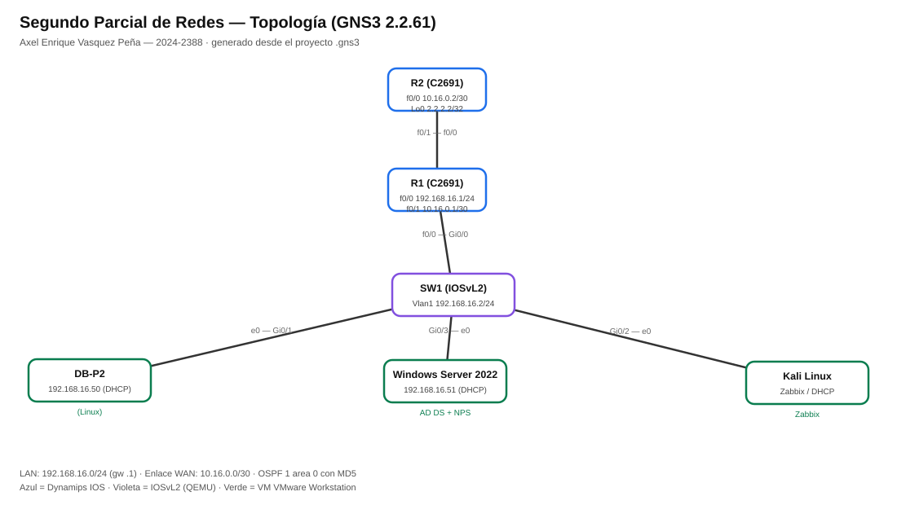

# Segundo Parcial de Redes — Laboratorio GNS3

**Alumno:** Axel Enrique Vasquez Peña  
**Matrícula:** 2024-2388  
**Asignatura:** Redes de Computadoras — Segundo Parcial  
**LInk del video:** https://youtu.be/vQhqx4WdDaw
**Fecha de ejecución:** 13 de noviembre de 2026

Implementación y verificación de los ocho requisitos del parcial sobre una topología
Cisco IOS + Windows Server 2022: DHCP, OSPF con autenticación, auditoría CIS,
AAA/RADIUS con Active Directory y NPS, direccionamiento, administración por SSH y
monitoreo con SNMPv3/Zabbix.

> Todas las evidencias de este README son salidas reales del laboratorio. Las
> contraseñas, hashes, claves RADIUS y credenciales SNMP fueron reemplazados por
> `<REDACTADO>` antes de publicar.

---

## 1. Topología



*Diagrama generado desde el archivo `.gns3` del proyecto (`tools/make_diagram.py`).*

| Nodo | Plataforma | Interfaz | Dirección |
|---|---|---|---|
| R1 | Cisco C2691, IOS 12.4(25d) | f0/0 | 192.168.16.1/24 |
| R1 | | f0/1 | 10.16.0.1/30 |
| R2 | Cisco C2691, IOS 12.4(25d) | f0/0 | 10.16.0.2/30 |
| R2 | | Loopback0 | 2.2.2.2/32 |
| SW1 | Cisco IOSvL2 15.2 | Vlan1 | 192.168.16.2/24 |
| DC01 | Windows Server 2022 | e0 → Gi0/3 | 192.168.16.51/24 |
| DB-P2 | Linux (VMware) | e0 → Gi0/1 | 192.168.16.50/24 (DHCP) |
| Kali | Linux (VMware) | e0 → Gi0/2 | 192.168.16.52/24 (DHCP) |

Enlaces: `R1 f0/0 — SW1 Gi0/0`, `R1 f0/1 — R2 f0/0`, `SW1 Gi0/1 — DB-P2`,
`SW1 Gi0/2 — Kali`, `SW1 Gi0/3 — DC01`.

## 2. Direccionamiento

| Segmento | Máscara | Uso |
|---|---|---|
| 192.168.16.0 | /24 | LAN de servidores y clientes (gateway 192.168.16.1) |
| 10.16.0.0 | /30 | Enlace punto a punto R1–R2 |
| 192.168.16.1–49 | — | Excluidas del pool DHCP |
| 192.168.16.50–254 | — | Pool DHCP dinámico |
| 192.168.16.51 | /24 | Reserva manual para DC01 |
| 2.2.2.2 | /32 | Loopback de R2 (router-id OSPF) |

Se respetó el direccionamiento preexistente; no se renumeró ningún segmento.

## 3. Requisitos implementados

| # | Requisito | Estado | Evidencia |
|---|---|---|---|
| R1 | DHCP en R1 | ✅ | [`evidence/r1_dhcp_test.txt`](evidence/r1_dhcp_test.txt) |
| R2 | OSPF con autenticación MD5 | ✅ | [`evidence/health_check.txt`](evidence/health_check.txt), [`configs/r2_base_ospf.cfg`](configs/r2_base_ospf.cfg) |
| R3 | Auditoría CIS (22 controles) | ✅ | [`informe_CIS.md`](informe_CIS.md), [`evidence/cis_final.md`](evidence/cis_final.md) |
| R4 | AAA / RADIUS / AD / NPS | ✅ | [`evidence/r4_ad_nps.txt`](evidence/r4_ad_nps.txt), [`r4_radius_tests.txt`](evidence/r4_radius_tests.txt), [`r4_r1_aaa.txt`](evidence/r4_r1_aaa.txt), [`r4_ssh_radius.txt`](evidence/r4_ssh_radius.txt) |
| R5 | Publicación en GitHub | ✅ | Este repositorio |
| R6 | Direccionamiento y conectividad | ✅ | [`evidence/health_check.txt`](evidence/health_check.txt), [`evidence/r1_dhcp_test.txt`](evidence/r1_dhcp_test.txt) |
| R7 | SSHv2 en router y switch | ✅ | [`evidence/r7_ssh_test.txt`](evidence/r7_ssh_test.txt), [`evidence/r4_ssh_radius.txt`](evidence/r4_ssh_radius.txt) |
| R8 | SNMPv3 + Zabbix | ✅ | [`evidence/r8_snmpv3_kali.txt`](evidence/r8_snmpv3_kali.txt), [`evidence/r8_zabbix_hosts.txt`](evidence/r8_zabbix_hosts.txt) |

> **Nota CIS:** la auditoría final se ejecutó antes de implementar AAA. El control
> 3.1.1 de R1 se completó después; con esa actualización R1 queda en **18 PASS,
> 1 MANUAL y 3 FAIL**. La evidencia está en `evidence/r4_r1_aaa.txt`. El informe
> conserva la foto original del 13-nov-2026 10:29 para trazabilidad.

---

## 4. Evidencias reales

### R1 — DHCP

Pool `LAN` (192.168.16.50–254), direcciones `.1–.49` excluidas y reserva manual
`SRV-AD` para DC01 por `client-identifier`.

```text
Bindings from all pools not associated with VRF:
IP address          Client-ID/                 Lease expiration        Type
                    Hardware address/
                    User name
192.168.16.50       ff2b.9434.c100.0200.       Mar 02 2002 12:01 AM    Automatic
                    00ab.11d1.5623.315d.
                    22da.4c
192.168.16.51       0100.0c29.f7e0.b0          Infinite                Manual
192.168.16.52       0063.6973.636f.2d30.       Mar 01 2002 08:37 AM    Automatic
                    6338.612e.3237.3330.
                    2e38.3030.312d.566c.
                    31
```

Prueba de extremo a extremo: SW1 se configuró temporalmente como cliente DHCP,
recibió `192.168.16.52/24` con gateway `.1` y lease de 8 h, y los contadores
`DHCPDISCOVER`, `DHCPREQUEST`, `DHCPOFFER` y `DHCPACK` pasaron de 2 a 3. Después
se restauró la IP estática `192.168.16.2` y se verificó con 4/4 pings.

### R2 — OSPF con autenticación

```text
R1# show ip ospf neighbor
Neighbor ID     Pri   State           Dead Time   Address         Interface
2.2.2.2           1   FULL/BDR        00:00:34    10.16.0.2       FastEthernet0/1

R2# show ip ospf neighbor
Neighbor ID     Pri   State           Dead Time   Address         Interface
1.1.1.1           1   FULL/DR         00:00:30    10.16.0.1       FastEthernet0/0
```

OSPF 1, área 0, `router-id` 1.1.1.1/2.2.2.2 y autenticación `message-digest`
MD5 clave 1. R2 aprende `O 192.168.16.0/24` y R1 aprende `O 2.2.2.2/32`.
La adyacencia no sube si la clave MD5 no coincide.

### R3 — Auditoría CIS

| Equipo | Controles | PASS final | MANUAL | FAIL final | N/A |
|---|---|---|---|---|---|
| R1 | 22 | 17 | 1 | 4 | 0 |
| SW1 | 22 | 15 | 1 | 4 | 2 |

Controles destacados que pasan: `enable secret` cifrado, SSHv2, Telnet/HTTP
deshabilitados, `no ip source-route`, CDP deshabilitado en puertos de acceso,
SNMPv3 con auth+priv y OSPF con MD5.

Pendientes documentados con su riesgo: syslog centralizado, clientes NTP y CoPP.
CoPP no aplica en IOSvL2; DC01 ya ofrece NTP, pero no se modificaron las
configuraciones verificadas de R1/SW1 para no romper el laboratorio. El detalle
completo está en [`informe_CIS.md`](informe_CIS.md).

### R4 — AAA / RADIUS / Active Directory / NPS

**Dominio y usuarios**

```text
DNSRoot           : parcial.local
NetBIOSName       : PARCIAL
DC01              192.168.16.51   Windows Server 2022   Global Catalog
OU=Laboratorio,DC=parcial,DC=local
  OU=Usuarios, OU=Grupos, OU=Equipos
radius1  -> GRP-Usuarios-RADIUS       msNPAllowDialin = True
vasquez  -> GRP-Administradores-TI    msNPAllowDialin = True
```

**Clientes RADIUS y política NPS**

```text
Name        Address          Enabled
R1          192.168.16.1     True
SW1         192.168.16.2     True
KALI-TEST   192.168.16.52    True

Connections to other access servers
NP-Authentication-Type  0x1009  "0x3" "0x4" "0x9" "0xa" "0x1"   (incluye PAP)
```

NPS escucha UDP 1812/1813 en `192.168.16.51`; la regla de firewall permite esos
puertos **solo** desde `192.168.16.0/24`. El servicio `IAS` está en ejecución y
la auditoría de NPS está habilitada.

**Access-Accept y Access-Reject reales (radtest desde Kali)**

```text
== 1) USUARIO VALIDO + PASSWORD CORRECTA ==
Received Access-Accept Id 205 from 192.168.16.51:1812 to 192.168.16.52:36286

== 2) USUARIO VALIDO + PASSWORD INCORRECTA ==
Received Access-Reject Id 246 from 192.168.16.51:1812 to 192.168.16.52:47427

== 3) USUARIO INEXISTENTE ==
Received Access-Reject Id 24 from 192.168.16.51:1812 to 192.168.16.52:39390
```

**AAA en R1**

```text
aaa new-model
aaa authentication login default group radius local
ip radius source-interface FastEthernet0/0
radius-server host 192.168.16.51 auth-port 1812 acct-port 1813 key 7 <REDACTADO>
radius-server retransmit 2
radius-server deadtime 1

R1# show aaa servers
RADIUS: id 1, priority 1, host 192.168.16.51, auth-port 1812, acct-port 1813
     State: current UP

R1# test aaa group radius radius1 <REDACTADO> new-code
User successfully authenticated
```

**Login SSH con usuario del dominio**

```text
ssh radius1@192.168.16.1
C*** PARCIAL REDES - Acceso restringido a personal autorizado ***
R1# show clock
*01:10:02.995 UTC Fri Mar 1 2002

# password incorrecta / usuario inexistente
Permission denied, please try again.
```

La cadena completa queda demostrada: R1 consulta a NPS, NPS valida contra Active
Directory y la sesión SSH queda autenticada. Los eventos de Windows confirman
`6272` (acceso concedido) y `6273` (acceso denegado).

### R5 — GitHub

Este repositorio contiene el README con las evidencias, el informe CIS, el
diagrama, las configuraciones finales saneadas y las salidas reales de los
comandos. Antes de publicar se verificó que no hubiera contraseñas, hashes,
claves RADIUS, tokens ni archivos de la bóveda `.vault`.

### R6 — Direccionamiento y conectividad

```text
SW1# show ip interface brief | include Vlan1
Vlan1                  192.168.16.2    YES manual up                    up

SW1# show ip route
Gateway of last resort is 192.168.16.1 to network 0.0.0.0
S*    0.0.0.0/0 [1/0] via 192.168.16.1
C     192.168.16.0/24 is directly connected, Vlan1

SW1# show interfaces status
Gi0/0   UPLINK-R1-f0/0      connected   1   a-full   auto
Gi0/1   DB-P2               connected   1   a-full   auto
Gi0/2   Kali-Zabbix         connected   1   a-full   auto
Gi0/3   WindowsServer-AD-N  connected   1   a-full   auto
```

Conectividad verificada: 4/4 pings de R1 a SW1 (`192.168.16.2`) y 4/4 pings de
SW1 a R1 y a la WAN `10.16.0.2`. Hostnames `R1`, `R2` y `SW1` configurados.

### R7 — SSHv2

```text
R1# show ip ssh
SSH Enabled - version 2.0
Authentication timeout: 60 secs; Authentication retries: 3

line vty 0 4
 logging synchronous
 login local
 transport input ssh
```

Prueba real de sesión SSH desde R2 hacia R1 con el usuario local, banner y
prompt `R1#`. En el estado final R1 usa AAA/RADIUS para la VTY y el acceso se
demuestra con `radius1`; SW1 conserva el usuario local `admin`. Telnet y HTTP
están deshabilitados.

### R8 — Zabbix y SNMPv3

```text
Zabbix 7.0.29 sobre Kali Linux 192.168.16.52
URL: http://192.168.16.52/zabbix

Hosts registrados (grupo "Laboratorio Redes", plantilla "Cisco IOS by SNMP"):
  R1   192.168.16.1  SNMPv3 authPriv SHA/DES     hostid 10683
  SW1  192.168.16.2  SNMPv3 authPriv SHA/AES128  hostid 10684

Valores reales (item.get, estado=0 sin error):
  R1   sysName = "R1.parcial.local"   sysUpTime = 123494 timeticks
  SW1  sysName = "SW1.parcial.local"  sysUpTime = 120992 timeticks
  triggers = 5 por equipo
```

Consulta SNMPv3 directa desde Kali:

```text
snmpwalk -v3 -l authPriv -u zabbix -a SHA -A *** -x DES -X *** 192.168.16.1 1.3.6.1.2.1.1
iso.3.6.1.2.1.1.5.0 = STRING: "R1.parcial.local"
iso.3.6.1.2.1.1.6.0 = STRING: "Laboratorio-Parcial-Redes"
```

---

## 5. Estructura del repositorio

```text
.
├─ README.md
├─ informe_CIS.md              Informe de auditoría CIS (inicial + final)
├─ PROGRESO.md                 Bitácora y estado de continuidad
├─ configs/                    Fragmentos de configuración aplicados (placeholders)
├─ configs_equipos/            Configuración final exportada por equipo (secretos redactados)
├─ evidence/                   Salidas reales de los comandos de verificación
├─ docs/                       Diagrama de topología (SVG)
├─ imagenes/                   Copia del diagrama para el README
└─ tools/                      Automatización (Python + Netmiko + API GNS3)
```

## 6. Automatización

| Script | Función |
|---|---|
| `tools/gns3api.py` | Cliente de la API GNS3 (credenciales leídas del servidor local) |
| `tools/cisco.py` | Consola Netmiko: `python cisco.py R1 "show ip route"` |
| `tools/apply.py` | Aplica un `.cfg` con placeholders desde la bóveda local |
| `tools/backup_all.py` | Respaldo de `running-config` por fecha |
| `tools/cis_audit.py` | Auditoría CIS automatizada (22 controles) |
| `tools/verify_r1_dhcp.py` | Prueba DHCP de extremo a extremo |
| `tools/verify_r7.py` | Prueba de login SSH real |
| `tools/make_diagram.py` | Genera el diagrama desde el `.gns3` |
| `tools/export_configs.py` | Exporta configuraciones saneadas |
| `tools/sanitize_evidence.py` | Redacta secretos en las evidencias JSON |

Requisitos: Python 3.10+, `netmiko`. Los accesos a consola se toman del servidor
GNS3 (`192.168.6.128:5000/5001/5003`).

## 7. Seguridad

- No se publican contraseñas, hashes, claves RADIUS, tokens ni la bóveda `.vault`.
- `.gitignore` excluye `.vault/`, `backups/`, `evidence/vm/`, `__pycache__/`,
  `*.pyc`, entornos virtuales y el archivo de entrega con datos personales.
- Las configuraciones de `configs_equipos/` reemplazan todo secreto por
  `<REDACTADO>`; las evidencias JSON pasaron por `tools/sanitize_evidence.py`.
- Los fragmentos de `configs/` usan placeholders (`{{ADMIN_SSH}}`,
  `{{SNMP_AUTH}}`, …) resueltos desde una bóveda local excluida del repositorio.

## 8. Video demostrativo

**Enlace de YouTube:** _pendiente de publicación; se añadirá cuando el video esté subido._

<!-- Reemplazar la línea anterior por el enlace real de YouTube al publicar el video. -->

## 9. Estado y pendientes

- [x] R1 DHCP
- [x] R2 OSPF con autenticación
- [x] R3 Auditoría CIS
- [x] R4 AAA / RADIUS / AD / NPS
- [x] R5 Publicación en GitHub
- [x] R6 Direccionamiento y conectividad
- [x] R7 SSHv2
- [x] R8 Zabbix con SNMPv3

Pendientes documentados de CIS (no aplicados para no modificar configuraciones ya
verificadas): syslog centralizado, clientes NTP y CoPP. El servidor NTP de DC01
está configurado; los clientes NTP de R1/SW1 quedan como mejora. El enlace del
video se agregará al publicarlo.
